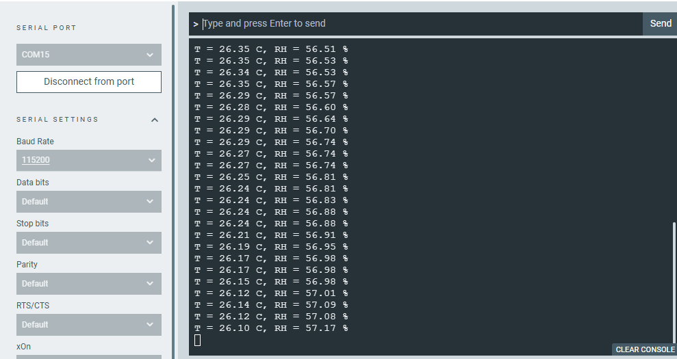

# ble-sensor-node

Battery-powered BLE environmental sensor node on the nRF54L15 DK, built with Zephyr RTOS (nRF Connect SDK).

## Goal

Read temperature and humidity from an SHT30 over I2C using a driver written from the datasheet, and expose the data over BLE through a custom GATT service with notifications.

## Hardware

- Board: nRF54L15 DK (PCA10156 v1.0.0), build target `nrf54l15dk/nrf54l15/cpuapp`
- Sensor: SHT30 breakout, I2C address `<0x44 or 0x45>`
- Wiring: SCL on P1.11, SDA on P1.12 (`i2c22`), VCC on VDD:IO, GND on GND
- VDD set to 3.3 V in nRF Connect Board Configurator



## Software

- nRF Connect SDK v3.4.2 LTS, Zephyr RTOS
- VS Code with the nRF Connect extension
- Custom devicetree binding for the sensor (`dts/bindings/nyxano,sht30.yaml`)
- Own SHT30 driver code (`src/sht30.c`, `src/sht30.h`):
  - single-shot measurement, high repeatability, clock stretching disabled
  - CRC-8 check of both data words (polynomial 0x31, init 0xFF), verified against the datasheet test vector (0xBEEF gives 0x92)
  - integer math only: values in hundredths of °C and %RH, frame rejected on CRC mismatch
- Measurement loop in `main.c`: one reading per second

## Project layout

| Path | Purpose |
|---|---|
| `src/main.c` | Application: measurement loop and console output |
| `src/sht30.c`, `src/sht30.h` | SHT30 driver: init, CRC-8, read and conversion |
| `prj.conf` | Kconfig options (e.g. `CONFIG_I2C=y`) |
| `boards/nrf54l15dk_nrf54l15_cpuapp.overlay` | Devicetree overlay: LED alias, `i2c22` pins, SHT30 node |
| `dts/bindings/nyxano,sht30.yaml` | Devicetree binding for the SHT30 |

## Build and flash

1. Open the project in VS Code with the nRF Connect extension and SDK v3.4.2.
2. Build configuration: board target `nrf54l15dk/nrf54l15/cpuapp`, build directory `build`.
3. Build and flash. Console output is on the second virtual serial port of the DK (115200 baud).

## Example output

```
T = 26.98 C, RH = 56.27 %
T = 26.96 C, RH = 56.06 %
T = 26.94 C, RH = 55.85 %
```

Touching the sensor with a finger makes both values rise (about 31 °C and 75 %RH), which confirms real measurements.

## Status

- [x] Environment, build and flash (blinky)
- [x] Devicetree overlay: `led0` alias redirected to `led1`
- [x] SHT30 node on `i2c22` with own binding, ACK confirmed (soft reset)
- [x] CRC-8 with datasheet test vector
- [x] Temperature and humidity read (single shot, CRC check, conversion)
- [x] Sensor code split into `sht30.c` / `sht30.h`
- [ ] Unit tests (Twister / ZTest)
- [ ] BLE advertising and custom GATT service

## Notes

- Zephyr code finds hardware through devicetree aliases (e.g. `DT_ALIAS(led0)`), while a node label (e.g. `led1`) names one specific node. My overlay points the `led0` alias at the `led1` node, so a different LED blinks without any change in `main.c`.
- I2C returned `-5` (`-EIO`) at first, which means the sensor did not ACK. The cause was SDA wired to the wrong header pin. After fixing it, the soft reset command returned 0.
- A new file (overlay, binding, source file in `CMakeLists.txt`) needs a pristine build, because CMake only finds new files during configuration. Editing existing files is picked up by a normal build.
- The driver functions return a status code and hand results back through pointers, so a CRC error (`-EIO`) can be told apart from a valid reading.